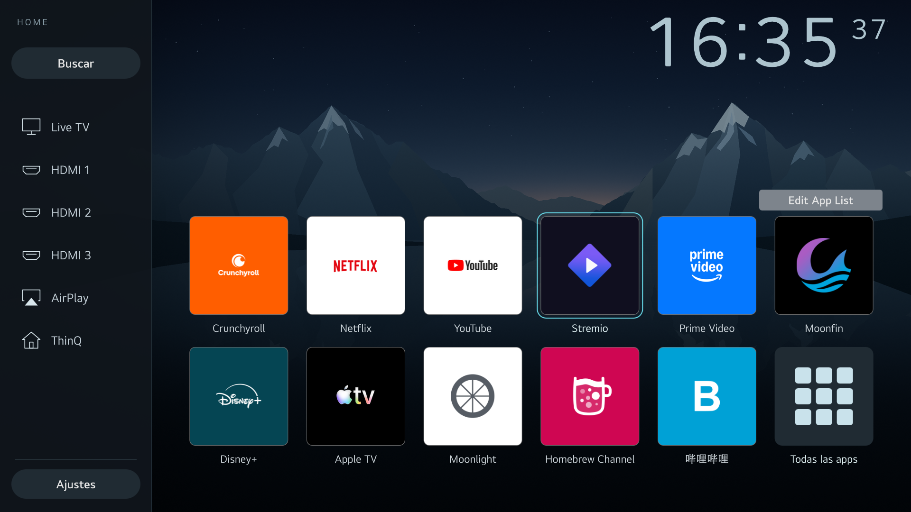

# LG webOS Native Home

Reversible customisation of the native Home on a rooted LG TV. It does not install another launcher: it changes the presentation of `com.webos.app.home`, keeps its LaunchPoints and original actions, and adds non-visual policies inside the existing compositor.

The device side is a single static Rust binary, `lg-native`, built for very low memory use: every command is a short-lived process of well under 1 MiB resident memory, with no daemon, no interpreter and no runtime dependencies on the TV.



## Status and scope

The behaviour was tested on an LG 50UQ8050PSB, webOS 7.6.0 / webOS 22, firmware 04.60.90, aarch64, with Homebrew Channel 0.7.3. No compatibility with other models or versions is claimed. Root and administrative access are prerequisites; this repository does not obtain root and contains no exploit.

The physical tests listed in [docs/verification.md](docs/verification.md) were performed with the earlier Python implementation. The Rust port reproduces that behaviour and is verified offline (see [Verification of the Rust port](#verification-of-the-rust-port)), but it **has not yet been run on the TV**. Deploy it with the same recovery precautions as a new installation.

Published here: code, reproducible modifications, tests and documentation. Excluded: keys, credentials, private logs, network settings, accounts, full backups, binaries and complete copies of LG firmware. The originals needed to rebuild the interface must be obtained legally from your own device.

## Features

- The same native Home, without ads/categories and without an alternative dashboard.
- Static local landscape background, six-column grid and 208 px icons.
- Sidebar: Search, TV, HDMI 1/2/3, AirPlay, USB only when real storage is present, ThinQ, and Settings last.
- Eleven favourites plus "All apps" as the twelfth tile. Extended catalogue without modifying the native model.
- Order: Crunchyroll, Netflix, YouTube, Stremio, Prime Video, Moonfin, Disney+, Apple TV, Moonlight, Homebrew Channel and Bili.
- Boxless clock: 152.5 px hours/minutes, 61 px seconds raised, colour `#ADC4CE`, fixed cells per digit. Updates only while Home is visible.
- The Google Assistant button toggles the pointer. Off by default at start/resume, no expiry once enabled manually. MOVIES opens Crunchyroll.
- Eight read-only overrides with hash, ownership, inode and mount validation; bounded recovery.
- A non-visual gate keeps a previous Home window from being shown until the overrides and that window's marker are verified.

The on-screen labels are English by default ("Search", "Settings", "All apps"). The byte-exact, physically verified build used Spanish labels; it can still be produced with `--labels original` (see [home/README.md](home/README.md)).

TV, inputs, picture/sound, CEC/ARC, AirPlay, ThinQ/HomeKit, the store and shared engines are outside the scope of any indiscriminate removal. Hiding an app does not uninstall it. No ROMs, BIOS files or application data are included.

## Layout

| Path | Contents |
| --- | --- |
| `crates/lg-native/` | The device binary and library: Home runtime, gate recovery/installer/trial guard, remote-control ownership, checkpoint helper. |
| `crates/lg-native-host/` | Offline host tools: Home delta builder, content-addressed asset packers, publication check. |
| `xtask/` | `cargo xtask test`: runs every offline suite. |
| `home/` | Presentation deltas and firmware allowlist; not the complete firmware. |
| `runtime/` | The boot hook `55-lg-native`. |
| `gate/` | QML/JS gate assets (run inside the compositor), their JavaScript tests and synthetic fixtures. |
| `remote/` | QML/JS remote-control assets and their JavaScript tests. |
| `docs/` | Architecture, manual procedure, observed tests and limits. |

QML and JavaScript remain only where they must: inside the existing compositor's QML engine. Everything that previously ran as a Python process on the TV or the host is now Rust.

## Checking the repository without a TV

Host: Rust 1.74 or later (via [rustup](https://rustup.rs)), Node.js 20 or later for the in-compositor JavaScript tests, and `sh` on `PATH` (for example Git Bash on Windows) for the hook syntax check. Nothing in the test suite contacts a TV.

```sh
cargo xtask test
```

This runs formatting and lint checks, all Rust unit and integration tests, the JavaScript asset tests, the boot-hook syntax check and the publication check, stopping at the first failure. A local run is not a CI result.

The tests use synthetic fixtures labelled as such. They neither contain nor simulate physical test results: see [docs/verification.md](docs/verification.md) for the evidence and its limits.

## Building the TV binary

```sh
rustup target add aarch64-unknown-linux-musl
cargo build --release -p lg-native --target aarch64-unknown-linux-musl
# -> target/aarch64-unknown-linux-musl/release/lg-native (static, stripped, ~0.6 MB)
```

The binary is statically linked against musl, so it does not depend on the TV's C library. `rust-lld`, shipped with rustup, is the linker (configured in `.cargo/config.toml`); no cross C toolchain is needed. Check the TV's userland first (for example `uname -m` and the ELF class of an existing binary): if it is 32-bit ARM, use `armv7-unknown-linux-musleabihf` instead.

## Rebuilding the interface

Keep a copy of the eight original QML/JS files of the stated firmware outside the repository, preserving the structure under `qml/`. Do not copy files that are already covered by a bind mount as if they were originals. See [home/README.md](home/README.md) for the exact command, the hash validation and the generation of the eight overrides.

The background is an external local asset: use your own image or one you have permission to use, at the path the payload requires. The background file is not distributed as a reusable asset. The screenshot in this README only documents the implementation.

Generated outputs are private and ignored by Git. Do not run historical scripts from other phases against an existing installation.

## Installation and recovery

There is no universal one-command installer. [docs/deployment.md](docs/deployment.md) explains the prerequisites, the manual staging, the installation order, the recovery points and how to migrate an installation made with the earlier Python implementation. Review the code before running anything as root.

The remote-control remapping is independent of the eight overrides and of their gate. Its packages can be generated without connecting a TV:

```sh
cargo run --release -p lg-native-host -- pack-remote
# Writes remote/remote-packed-final/package.json and three SHA256-named assets.
```

On the TV, only after reviewing compatibility, staging, permissions and an independent recovery path:

```sh
/var/lib/lg-native/lg-native remote install /var/lib/lg-native/remote-final-package.json
/var/lib/lg-native/lg-native remote check
# Reverts only the remapping; keeps the gate and foreign filters:
/var/lib/lg-native/lg-native remote disable
```

`remote check` verifies integrity and configuration; it does not by itself prove that the physical remote works. Never replace the whole filter chain with a saved list of 17, 18 or 19 entries.

## Memory use

Peak resident memory per process, measured on an x86_64 development host (the earlier implementation on Python 3.13; `lg-native` as a static musl build). Values on the TV will differ in detail but not in order of magnitude:

| Operation | Python | Rust |
| --- | ---: | ---: |
| `gate disable` (no gate state) | 12.6 MiB | 0.6 MiB |
| checkpoint dry run | 10.1 MiB | 0.5 MiB |
| trial guard watcher (stays resident up to 240 s) | 11.6 MiB | 0.7 MiB |
| help text (interpreter and argument parser start-up) | 16.3 MiB | 0.6 MiB |

The design keeps it that way: one process per command, no threads or async runtime, streaming SHA-256 through a 16 KiB stack buffer, a 1 MiB cap on every state file and service response, `poll(2)` instead of reader threads for child output, `mount(2)`/`umount2(2)` system calls instead of spawning `mount`, and a size-optimised, statically linked release build with no unwinding tables.

## Verification of the Rust port

- Every behaviour covered by the Python tests is covered by Rust tests (122 in total). Tests of Python-only mechanics (dynamic module loading, `mount` command vectors) were replaced by tests of their Rust equivalents, and real-filesystem tests were added for symlinks, hard links, modes and oversize input.
- Transaction parity: the Rust controller and the Python controller produced identical journals and identical side-effect sequences for apply, rollback, an injected mid-transaction failure with recovery, and a legacy-journal migration.
- Packaging parity: the Rust packers produce byte-identical gate and remote assets and packages, so existing installations keep their exact content-addressed names.
- The Home delta engine matched the Python one on 3,000 randomised differential cases (outputs and error messages).
- State files keep their exact formats, so the Rust binary reads journals and ownership records written by the Python version.
- Built and tested with Rust 1.74 and 1.97; cross-compiled for aarch64 and armv7 musl.

None of this replaces a physical test on the TV.

## Important limits

- The native block appears to be a global pointer policy, not a setting exclusive to the Magic Remote sensor. A USB mouse and a phone touchpad need separate tests.
- Power off/on with the remote, software reboot and physical removal of power are different tests.
- Opening an app does not prove video playback, DRM, HDMI signal or casting.
- The gate keeps a recovery exit for integrity failures; it does not promise that the original Home can never be seen under any fault.
- Packaging and offline tests do not prove compatibility with different firmware.

No VNC, input injectors or resident diagnostic processes are added. Permanent behaviour lives in non-visual components of the existing compositor.

## Contributing

Read [AGENTS.md](AGENTS.md), write tests before changing behaviour and do not publish data from your TV. Include the exact firmware version, the scope of the test and the recovery used, without credentials or full dumps. Redistribution and provenance rules are in [NOTICE.md](NOTICE.md).
